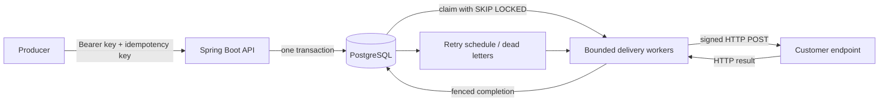

# RelayForge

**A webhook delivery backend built with Java 21, Spring Boot, and PostgreSQL.**

I built RelayForge around a simple question: what happens when another service needs an event, but its server is down? The application stores the event and the jobs needed to deliver it, then sends signed webhooks in the background. Temporary failures retry. Permanent failures remain visible so they can be investigated and replayed.

For example, an order service can publish `orders.created`. Billing and fulfilment can subscribe through separate endpoints, and each gets its own delivery record. Projects have separate API keys, endpoints, and delivery history.

I explain the idea in more detail in [ABOUT.md](ABOUT.md). You can also run a demo that shows retries and replay.

The latest local build passed **83 tests against real PostgreSQL 17** and produced a runnable jar. See [verification](docs/verification.md) for the exact checks I ran.

## What is implemented

| Concern | Implementation |
| --- | --- |
| Durable acceptance | One transaction commits the event, matching delivery jobs, quota changes, and audit record. |
| Duplicate submissions | A required idempotency key is scoped to a project. Equivalent JSON object key order is accepted; changed content returns `409`. |
| Concurrent workers | PostgreSQL `FOR UPDATE SKIP LOCKED` claims jobs without sharing a live lease. Network calls happen after the claim transaction commits. |
| Crash recovery | Expired leases can be reclaimed. A fresh lease token fences out a previous worker’s completion. |
| Failure handling | Bounded exponential backoff with jitter, capped `Retry-After`, permanent failure classification, and dead-letter replay. |
| Tenant isolation | The authenticated API key determines the project. Tenant-facing requests cannot choose a different project ID. |
| Webhook security | HMAC-SHA256 over the timestamp, delivery ID, and exact body; AES-256-GCM encryption of signing secrets. |
| Outbound safety | HTTPS by default, public-address validation at registration and connection time, no redirects, and no automatic HTTP retries. |
| Bounded work | Per-project pending delivery limits, durable event rate limits, payload limits, endpoint limits, and bounded worker concurrency. |
| Visibility | Attempt history, audit records, structured logs, request IDs, readiness checks, and protected Prometheus metrics. |
| Build and development | Maven Wrapper, Docker Compose, CI, dependency updates, contribution guidance, and an MIT license. |

## Try it locally

The simplest demo needs **Java 21**, internet access for the first dependency download, and an available port 8080 and 9000. It starts disposable PostgreSQL and a signature-verifying receiver. Maven does not need to be installed.

**Windows / PowerShell**

```powershell
powershell -ExecutionPolicy Bypass -File scripts/setup.ps1
.\mvnw.cmd -Plocal-demo test-compile exec:java
```

Leave that terminal running. In a second terminal:

```powershell
powershell -ExecutionPolicy Bypass -File scripts/demo.ps1 -ReceiverEndpoint http://localhost:9000
```

**Linux or Intel macOS**

```bash
sh scripts/setup.sh
sh ./mvnw -Plocal-demo test-compile exec:java
```

In a second terminal, with Python 3 installed:

```bash
RELAY_RECEIVER_ENDPOINT=http://localhost:9000 python3 scripts/demo.py
```

The demo checks that repeated submission returns the same event, a flaky receiver succeeds on its third attempt, and a permanent failure succeeds after dead-letter replay. The receiver prints whether each signature is valid. Stop the launcher with Ctrl+C; its database is disposable. PostgreSQL test binaries are provided for common desktop platforms; use Docker on unsupported architectures.

## Run the complete container stack

This option needs Docker with Compose. Generate `.env` with either setup script above, then:

```bash
docker compose up -d --build --wait
python3 scripts/demo.py
```

On Windows, run `powershell -ExecutionPolicy Bypass -File scripts/demo.ps1` for the second command.

| Service | Address |
| --- | --- |
| Interactive API documentation | http://localhost:8080/swagger-ui.html |
| OpenAPI JSON | http://localhost:8080/v3/api-docs |
| Readiness | http://localhost:8080/actuator/health/readiness |
| Demo receiver | http://localhost:9000/health |
| Optional Prometheus | http://localhost:9090 |

Start Prometheus with `docker compose --profile observability up -d`. `docker compose down` stops the stack and keeps the database volume. The Compose file binds published ports to loopback and deliberately permits the `receiver` development host. [Deployment guidance](docs/operations.md) explains how to configure a real environment.

## Make your first API request

The operator provisions a project. The returned API key is then used for that project’s routes:

```bash
curl -sS http://localhost:8080/api/v1/admin/projects \
  -H "Authorization: Bearer $RELAY_ADMIN_TOKEN" \
  -H 'Content-Type: application/json' \
  -d '{"name":"Order notifications"}'
```

The setup script writes credentials to `.env`; it does not export them into your shell. For this example, obtain `RELAY_ADMIN_TOKEN` from your local `.env` without committing or posting it. The automated demo loads the file itself.

Register an HTTPS endpoint with the returned project key, then publish an event:

```bash
curl -sS http://localhost:8080/api/v1/events \
  -H "Authorization: Bearer $PROJECT_API_KEY" \
  -H 'Idempotency-Key: order-42-created' \
  -H 'Content-Type: application/json' \
  -d '{"type":"orders.created","data":{"orderId":"order-42","amount":1299}}'
```

An accepted response is `202`; it means the work is durably queued. If no enabled endpoint subscribes to the event type, the event is stored with zero deliveries. See the [API guide](docs/api.md) for endpoint registration, pagination, replay, and errors.

## How delivery works



PostgreSQL is both the source of truth and the durable queue. This keeps the acceptance boundary straightforward and avoids adding a broker before one is justified. Workers use Java virtual threads with an explicit concurrency limit; virtual threads do not make the database or receivers unlimited. [The architecture guide](docs/architecture.md) covers the guarantees and tradeoffs.

## Run the tests

```bash
sh ./mvnw verify
```

Use `.\mvnw.cmd verify` on Windows. The suite creates an isolated PostgreSQL 17 database, runs Flyway migrations, and tests the application’s real SQL and transaction behavior. Docker is not required. The first run downloads PostgreSQL binaries and can take several minutes. Run as a regular OS user because PostgreSQL refuses to initialise as root.

Coverage is written to `target/site/jacoco/index.html`. [Testing notes](docs/testing.md) explain the scenarios and the limits of those checks. CI also defines a complete Compose demo job; see [verification evidence](docs/verification.md) for what was actually run in the development environment.

## A useful review path

For a quick look at the implementation, start with [the code tour](docs/code-tour.md) and run the demo. The key pieces are:

1. [EventService](src/main/java/dev/relayforge/event/EventService.java): the acceptance transaction and idempotency behavior.
2. [DeliveryQueue](src/main/java/dev/relayforge/delivery/DeliveryQueue.java): concurrent claims, recovery, and lease fencing.
3. [HttpWebhookTransport](src/main/java/dev/relayforge/delivery/HttpWebhookTransport.java): signing and connection-time DNS checks.
4. [Integration tests](src/test/java/dev/relayforge/RelayForgeIntegrationTest.java): adversarial and concurrent scenarios on PostgreSQL.
5. [Architecture decisions](docs/decisions): why the project uses this queue and these delivery semantics.

## Scope and next steps

The service provides **at-least-once delivery within a bounded retry budget**. A receiver may process a webhook before the sender crashes, so receivers must deduplicate using `Webhook-Id`. There is no guarantee of event ordering. Pausing an endpoint stops new matching deliveries and future claims; an already running request may finish.

There is no circuit breaker, per-destination fairness scheduler, general request rate limiter, automatic retention policy, or high-availability deployment in this version. Database backups, encryption key management, network egress policy, and deployment-specific authentication belong to the operator. These are discussed in [operations](docs/operations.md) and [security](docs/security.md), with a concrete [roadmap](docs/roadmap.md).

## Put it on GitHub

This folder is already a Git repository on the `main` branch. Create an **empty** GitHub repository, then replace `YOUR_USERNAME` and the repository name in these commands:

```bash
git remote add origin https://github.com/YOUR_USERNAME/relayforge.git
git push -u origin main
```

The source, documentation, tests, and example configuration are included. Local credentials, build output, editor settings, and downloaded tools are covered by `.gitignore`. Before sharing a screenshot or log, check it for API keys and signing secrets.

Released under the [MIT license](LICENSE). Contributions are described in [CONTRIBUTING.md](CONTRIBUTING.md).
