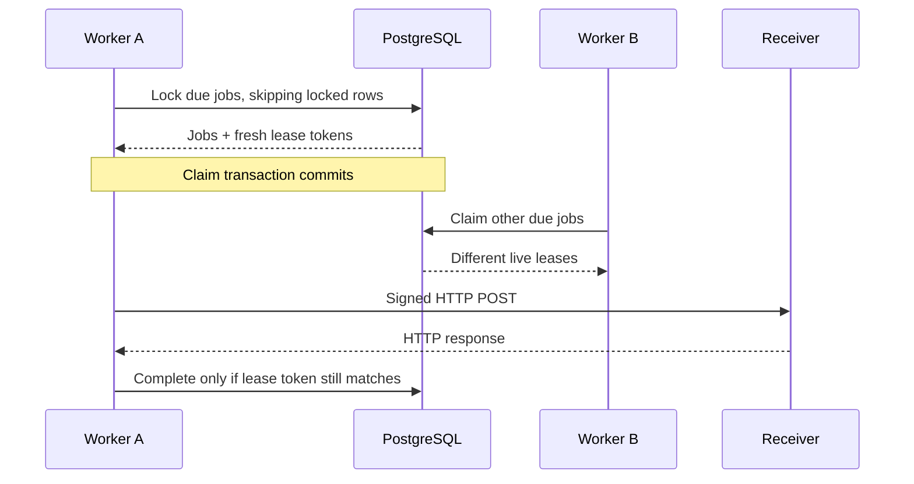
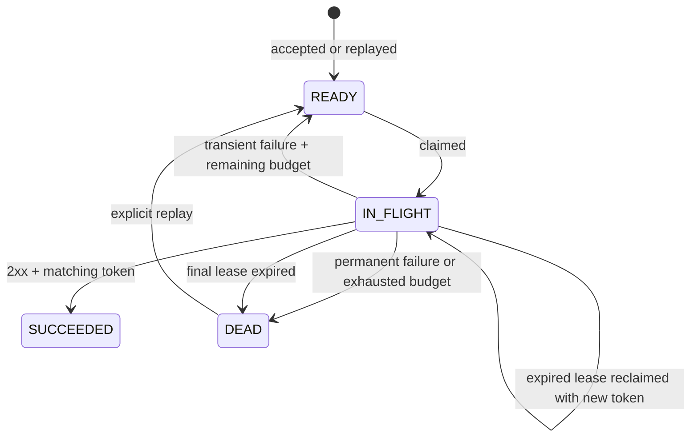
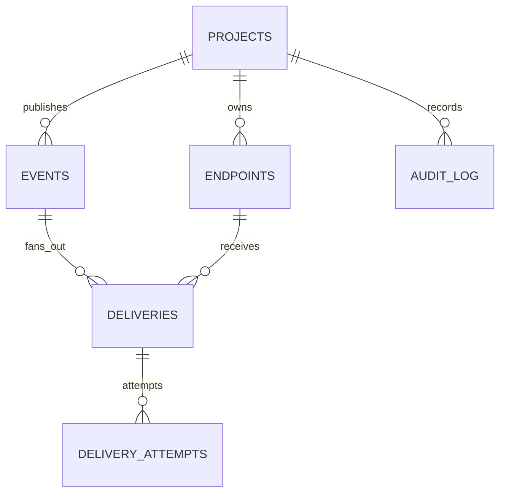

# Architecture and guarantees

RelayForge is one deployable Spring Boot application organised by capability: projects, endpoints, events, and deliveries. The HTTP API and worker share PostgreSQL. Each application instance can run its own worker, or set `RELAY_WORKER_ENABLED=false` to serve API traffic without polling the queue.

Keeping one deployable application makes the transaction boundary and local setup easy to inspect. The worker talks to the API’s database tables through `DeliveryQueue`; it does not call controllers or keep its queue in memory.

## The acceptance boundary

`EventService.publish` starts a transaction and locks the project row. It checks the idempotency key before consuming quota. An existing event with the same canonical request hash returns the original event ID and delivery count. Reusing the key for different content returns `409`.

For a new event, the transaction reads matching enabled endpoints, checks pending capacity, consumes the current minute’s event quota, and inserts the event, delivery jobs, and audit record. A database error rolls back all of those changes. `202 Accepted` is returned after the transaction commits.

The project lock also protects endpoint changes and replays that grow the queue. This makes the per-project capacity check safe when multiple application instances accept requests simultaneously. It serialises writes within a project, which is a deliberate throughput tradeoff. Different projects have different locks.

## The claim boundary

Workers select due `READY` jobs and expired `IN_FLIGHT` jobs using `FOR UPDATE OF d SKIP LOCKED`. Claiming assigns a random lease token, increments attempt counters, sets a lease deadline using the database clock, and records an `IN_PROGRESS` attempt. The claim transaction commits before any HTTP call begins.

The executor uses virtual threads, but a semaphore limits active work. Each poll claims only as many jobs as the instance has available slots. Database connection pool size and receiver capacity still bound useful concurrency.

## Recovery and fencing

An expired claim counts as an attempt because the previous worker may already have sent it. Recovery marks that attempt `LEASE_EXPIRED` and issues a new lease token. A previous worker’s completion is ignored if another worker has replaced its token. Expiry itself does not invalidate an unchanged token; ownership changes when a reclaim or reaper transaction commits.

If an expired claim has already consumed the retry budget, a reaper moves it to `DEAD`. This handles a worker that crashes on the final allowed attempt. The reaper runs in a bounded batch and also uses `SKIP LOCKED`.

The reaper also handles queued jobs that have already consumed a newly lowered retry budget. They become dead letters rather than waiting forever in a state that no worker can claim. Configure the same retry budget on every worker instance.

HTTP calls are outside database transactions. No row lock is held while waiting for a remote service.

## State transitions

The default budget is five claims per delivery cycle. Transport errors, `408`, `429`, and `5xx` are retryable. Other non-2xx responses, including redirects, are permanent. Backoff starts at a random delay between one and two seconds, doubles its ceiling with each attempt, and caps at five minutes. `Retry-After` can lengthen that delay up to the same cap.

Replay keeps the delivery ID and full attempt history, resets the cycle counter, and increments the replay counter. It is allowed only for dead-letter deliveries and is capped at ten replays. Replays consume the same submission quota and pending capacity budget as new work.

## What “at least once” means here

The sender cannot know whether a receiver committed its side effect when the connection fails before the acknowledgement returns. The receiver might also return success just before the worker crashes. Both cases can produce a duplicate HTTP delivery after recovery.

`Webhook-Id` is stable across retries and replay. The receiver should store that ID in the same transaction as its side effect and acknowledge an already processed ID. The event envelope is stored as text and reused byte for byte, so JSONB reformatting cannot invalidate its signature.

The system retries within a finite budget and makes terminal failures visible. It does not promise eventual success regardless of receiver behavior, exactly-once remote side effects, or ordered delivery.

## Data model

Composite foreign keys prevent a delivery from linking an event or endpoint from another project. A unique `(project_id, idempotency_key)` protects event identity, and a unique `(event_id, endpoint_id)` protects fanout identity. Partial indexes support ready and expired jobs; `(project_id, created_at DESC, id DESC)` supports keyset pagination.

Delivery pagination uses both timestamp and UUID. This remains unambiguous when multiple rows share a timestamp and avoids deep offset scans. Pagination is a traversal of changing data, not a point-in-time snapshot: status filters can change between pages.

## Scaling limits worth measuring

The first likely bottlenecks are the per-project acceptance lock, aggregate quota counts, PostgreSQL write volume, and receiver latency. Metrics snapshots also scan retained deliveries, and the schema has no automatic archival yet. The queue is globally ordered by due time; a high-volume tenant can dominate claims. A fairness scheduler and data retention would matter before a large shared deployment.

The HTTP client opens a fresh connection for each attempt so DNS policy is checked at the connection boundary. This is easy to reason about but costs extra TCP/TLS handshakes. A future pool must preserve that policy when connections expire or DNS changes.

See [ADR 001](decisions/001-postgres-queue.md), [ADR 002](decisions/002-delivery-semantics.md), and [ADR 003](decisions/003-security-boundaries.md) for the decisions behind these constraints.
